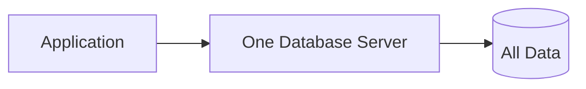
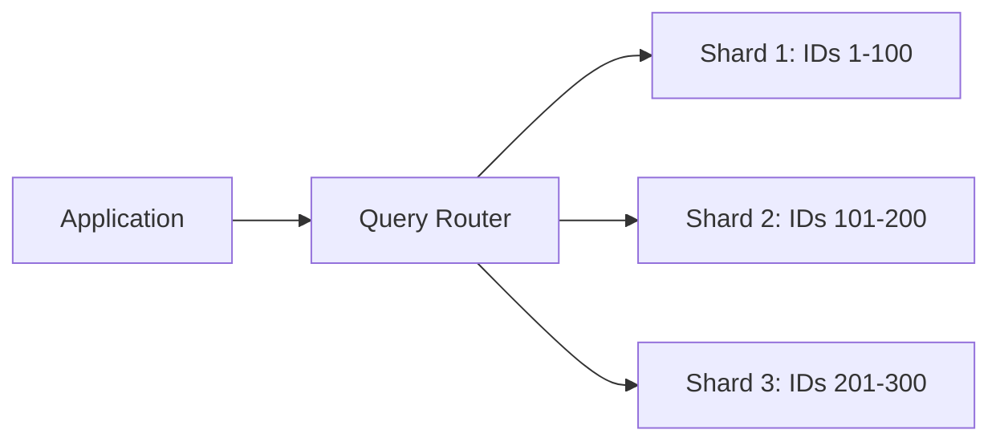
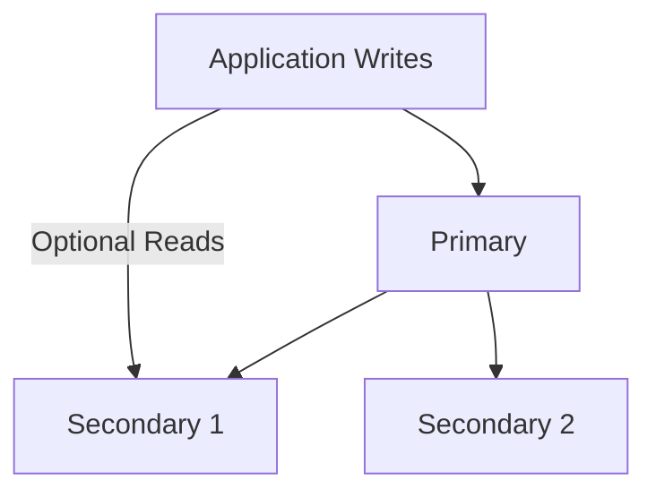
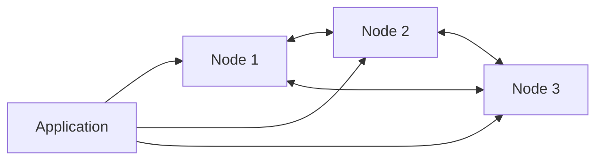
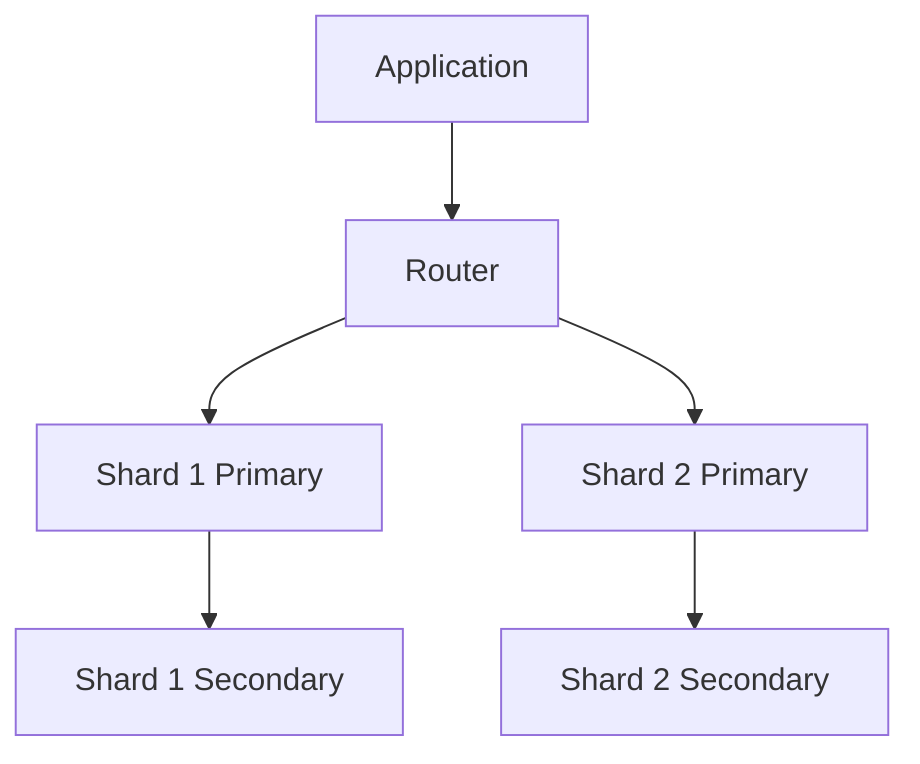

# Database Distribution Models

## 1. Single Server

- Data distribution: all records are stored on one server.
- Failure handling: if the server fails, database service is unavailable unless a backup/recovery system exists.
- Advantage: simple to install, operate and debug.
- Limitation: one machine limits capacity and is a single point of failure.
- Suitable application: small college project or local inventory system.

## 2. Sharding

- Data distribution: records are partitioned across shards using a shard key.
- Failure handling: sharding alone does not guarantee high availability; replicas are normally added to each shard.
- Advantage: spreads storage and workload across servers.
- Limitation: choosing a poor shard key can create uneven load and complex queries.
- Suitable application: large e-commerce catalogue or high-volume student portal.

## 3. Master-Slave / Primary-Secondary Replication

- Data distribution: primary accepts writes and copies changes to secondary nodes.
- Failure handling: an eligible secondary can be promoted, depending on the database's election and configuration.
- Advantage: improves availability and can support read scaling.
- Limitation: replication lag may occur; primary can be a write bottleneck.
- Suitable application: business application needing backup copies and read availability.

## 4. Peer-to-Peer Replication

- Data distribution: peer nodes coordinate; partitions/replicas are placed according to the database strategy.
- Failure handling: remaining replicas can serve requests if consistency level and replication factor permit.
- Advantage: no single permanent master; designed for distributed availability.
- Limitation: consistency, conflict handling and operations need careful design.
- Suitable application: global event ingestion or high-availability telemetry.

## 5. Sharding + Replication

- Data distribution: each shard stores a different partition; each partition has replica copies.
- Failure handling: a shard secondary may take over if its primary fails; other shards continue serving their partitions.
- Advantage: combines horizontal capacity with replica-based fault tolerance.
- Limitation: more servers, network, monitoring and administration are required.
- Suitable application: large online marketplace or nationwide service platform.

## Task 8 - MongoDB, Cassandra and Neo4j comparison

| Feature | MongoDB | Cassandra | Neo4j |
|---|---|---|---|
| Data model | Document | Wide-column | Graph |
| Storage | BSON documents in collections | Partitions, rows and columns | Nodes, relationships and properties |
| Query method | MongoDB Query API / aggregation | CQL | Cypher |
| Scalability | Sharding and replica sets | Peer-to-peer horizontal scaling | Depends on deployment/edition and graph workload |
| Suitable applications | Catalogues, profiles, content | Event logs, high-write workloads | Social networks, recommendations, connected data |

## Task 11 - Primary/Secondary vs Peer-to-Peer

Primary-secondary has a designated primary for writes and secondary replicas. Cassandra uses a peer-to-peer model in which nodes have equal roles and coordinate operations. A primary-secondary failure may require election/promotion. In Cassandra, remaining replicas can continue serving requests when the configured consistency level and replicas permit it.

## Task 13 - Combined design

Use two or more shards to split the dataset. Configure a replica set within each shard. The router directs each query to the relevant shard. Each shard's replica set maintains copies of that shard's data. Sharding improves capacity; replication improves availability and recovery. These mechanisms solve different problems and are commonly combined.
